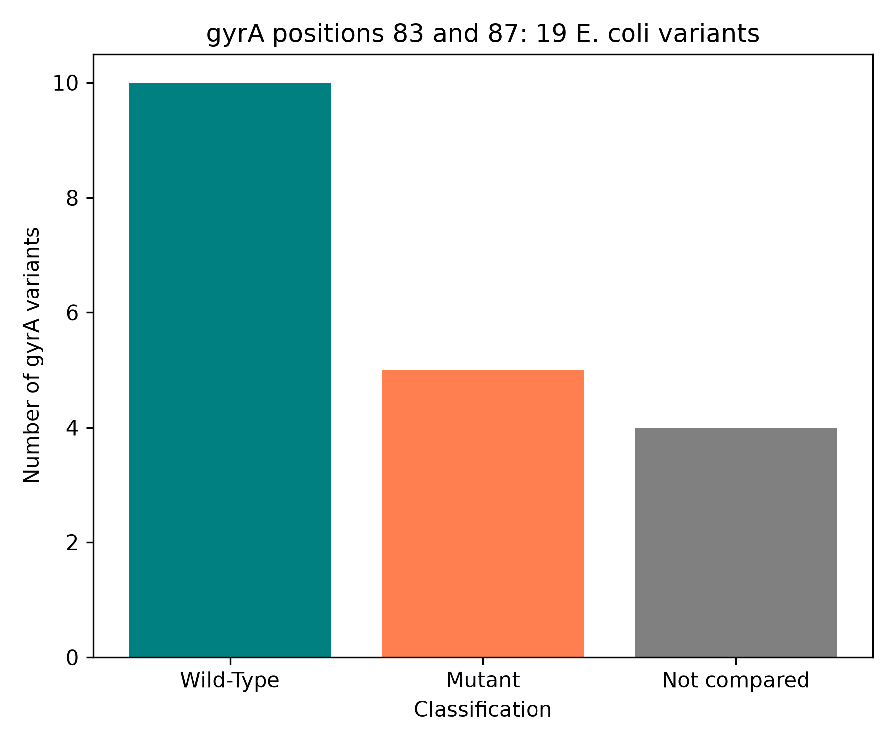

# Resistance Mutation Checker: E. coli gyrA

Fluoroquinolones are antibiotics that work by attacking an enzyme called DNA gyrase. In *E. coli*, a change at one of two spots in the gyrase protein GyrA can stop the drug from working. I wanted to see whether I could find those changes myself, using real protein sequences from NCBI.

This project takes 19 GyrA protein sequences from NCBI,compares each one to the standard K-12 reference at positions 83 and 87, and sorts them into Wild-Type, Mutant or Not compared.

Of the 19 sequences, 10 had no change at 83 or 87, 5 had a change, and 4 couldn't be compared because they were the wrong length.

---

## Background

**What gyrase does.** When a bacterium copies its DNA, the two strands get pulled apart and tension builds up ahead of the copying machinery,like twisting a rope tighter and tighter. Gyrase relieves that tension by cutting the DNA, passing another piece through the gap and sealing it again.It is made of two kinds of subunit, GyrA and GyrB. GyrA is encoded by the gene *gyrA*.

**What the drug does.** Fluoroquinolones like ciprofloxacin don't destroy gyrase. They trap it halfway through its job,after the DNA is cut but before it is sealed.The cell ends up with broken DNA and dies.

**Why positions 83 and 87.** Resistance changes cluster in a short stretch of GyrA called the QRDR (quinolone resistance-determining region), roughly amino acids 67 to 106. In the normal K-12 protein, position 83 is Serine (S) and position 87 is Aspartate (D). If either one is swapped, the drug grips gyrase more weakly.

**Mutation notation.** A mutation is written as normal letter, position, new letter. S83L means Serine at position 83 was replaced by Leucine. D87N means Aspartate at 87 was replaced by Asparagine. These two are the classic resistance changes.

**Why a reference.** A mutation only means something compared to a normal version. I used *E. coli* K-12 MG1655, which is not resistant and is the numbering most papers use. Its GyrA protein is `NP_416734.1`, 875 amino acids long, with S at 83 and D at 87. I checked both letters before using it.

---

## How it works

1. **Get the reference.** I searched NCBI's protein database for *gyrA* in *E. coli* K-12 with the RefSeq filter, which gave 11 records. I printed the ID, length and description of the first 5 and picked the one labelled MG1655. I saved its sequence to `sample_data/reference_gyrA.txt`.
2. **Search for other sequences.** I searched for *gyrA* in *E. coli* (12,651 records on Oct 4) and fetched the first 20.
3. **Look before trusting.** I printed the ID, length and description of all 20. One was the reference itself, so I skipped it. 15 were exactly 875 long, like the reference, and 4 were not.
4. **Compare.** For each of the 15, I took the letter at position 83 (`[82]` in Python) and position 87 (`[86]`) and compared them to the reference. A difference becomes a label like `S83L`. No labels means Wild-Type, any label means Mutant.
5. **Classic or not.** A separate column says whether the record has S83L or D87N.
6. **The other 4** got their own label, Not compared, because I couldn't check them (see below).
7. **Alignment check.** I aligned each of the 15 to the reference with `Bio.Align.PairwiseAligner` to make sure position 83 in each really lines up with position 83 in the reference.
8. **Table and chart.** The results went into a pandas DataFrame, saved as `outputs/gyra_mutation_report.csv`, and drawn as a bar chart.

---

## What I found

| Status | Sequences |
|---|---|
| Wild-Type | 10 |
| Mutant | 5 |
| Not compared | 4 |

**The 5 Mutant sequences:**

- 3 had **both S83L and D87N**: `WP_283799035.1`, `WP_504237252.1`, `WP_503377173.1`
- 1 had **S83L only**: `WP_506119039.1`
- 1 had **D87Y only**: `WP_506119563.1`. This is a different change at position 87 (Aspartate to Tyrosine). It is not one of the two classic changes, so its `classic_mutation` column says No. It is still a change at a resistance-associated position. I didn't check how strongly it affects resistance, so I haven't called it resistant.

The full table is in `outputs/gyra_mutation_report.csv`.

**The alignment check.** All 15 compared sequences are 875 amino acids long, the same as the reference, and all lined up with it in one unbroken stretch with no gaps. So nothing was inserted or deleted, and position 83 in each sequence really is position 83.
Being the same length does not mean being identical, though. With my scoring, the alignment score is the number of positions where the letter matches the reference. A perfect copy would score 875. Only YGJ20273.1 did. The other 14 scored between 870 and 874, so each has a few letters that differ from the reference somewhere in GyrA, even the ones I called Wild-Type. I didn't look at where those differences are.
So Wild-Type here means "no change at position 83 or 87", not "identical to the reference".

---

## The 4 I didn't compare

- `YGQ39239.1` is only 41 amino acids long and `YGQ39238.1` is 151, both marked "partial" by NCBI. The 41-long one has no 83rd letter at all, and asking for it gave an `IndexError`.
- `WP_104919505.1` and `WP_167584261.1` are 878 long, 3 more than the reference. With extra letters somewhere, their position 83 might not be the same spot as the reference's, so I didn't trust a plain letter comparison.

I gave these their own label, **Not compared**, Calling these Wild-Type would have been wrong. Wild-Type means I checked and found no change, and for these four I couldn't check.

---

## Things that broke along the way

- **The genome download hung.** I first tried to download the whole K-12 genome and pull out *gyrA*. With `gbwithparts` it ran for over 7 minutes and the interrupt button did nothing, so I had to restart the kernel.
- **Plain `gb` returned a stub.** It finished in about a minute, but `len(reference_record.features)` printed 1. There were no genes in it, so no *gyrA* to find. It was the same problem as in my CRISPR project. I fixed it by skipping the genome and fetching the GyrA protein directly, which is tiny and came back in seconds.
- **A search that returned 0.** My first protein search included the genome accession, and protein records don't carry it. Searching by gene name and organism worked.
- **A missing `len()`.** In my sorting loop I compared a sequence to a number, which is never True. Nothing crashed, but the output said Kept 0, Flagged 19. That didn't match the 3 odd-length records I had counted by eye, which is how I caught it.
- **The data changed.** On Oct 2 the search returned 12,647 records and on Oct 4 it returned 12,651, so the first 20 were different. My counts went from 16 kept and 3 flagged to 15 and 4. I redid everything with the new batch and saved the records to files, so the notebook now reads from files and not from live NCBI.

---

## Limitations

- **Only two positions are checked.** The QRDR is about 40 amino acids and other positions matter too. A Wild-Type sequence here could still carry a resistance change elsewhere.
- **These are protein variants, not strains.** Most records are `WP_` records, and one `WP_` record stands for one protein sequence that many strains can share. So "5 of 15" means 5 different protein versions had a change. It says nothing about how common resistance is in *E. coli*.
- **The 20 sequences are not a random sample.** They are just the first 20 the search returned, and the proportion changes with which 20 come back. My first batch had 8 of 16 with a change and the second had 5 of 15.
- **A change at 83 or 87 is not proof of resistance.** I only compared letters. I never tested whether any bacteria survive an antibiotic, and this is not a clinical tool.
- **The 4 Not compared sequences were never aligned.** Alignment might let me read positions 83 and 87 in the two 878-long ones, and that would change the counts. I didn't try it.
- - **Position numbering relies on the alignment check.** All 15 compared sequences are the same length as the reference and aligned without gaps, so I'm fairly confident in the numbering. I only checked the 15 compared sequences.

---

## What I learned
- **How to read and write mutation notation.** S83L is the normal letter, the position, then the new letter.
- A swap and a shift are different. A mutation replaces one letter and leaves every position the same. An insertion or deletion shifts everything after it, and alignment is what tells them apart.
- Length and alignment score are different things. Length is how many letters a sequence has, and the score is how many of them match the reference.
- "Checked and found nothing" and "couldn't check" need different labels.
- Code that runs without an error can still be wrong. The typo, the missing `len()` and the stub all ran fine, and the only clue was a number that looked off.
- Save slow or changing data to a file and read from the file afterwards.

---

## Running it

1. Clone this repository
2. Install the dependencies: `pip install -r requirements.txt`
3. Open `mutation_checker.ipynb` in Jupyter
4. Make sure `sample_data` and `outputs` folders exist next to the notebook, because saving files won't create them
5. Run the cells in order

The cells that search NCBI are saved as plain text in the notebook so they don't run. The notebook reads the reference and the 19 saved sequences from `sample_data/` instead, which keeps the results the same every time even though NCBI keeps adding records. If you want a fresh search, put your own email in `Entrez.email` and expect different numbers.